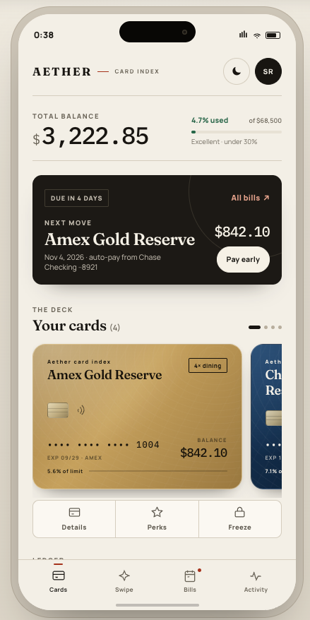
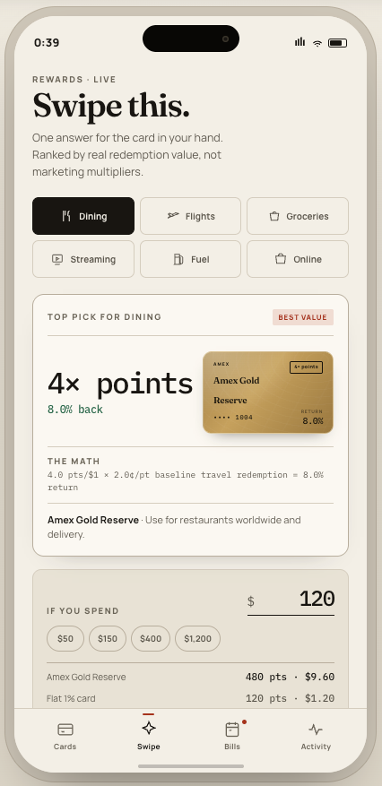
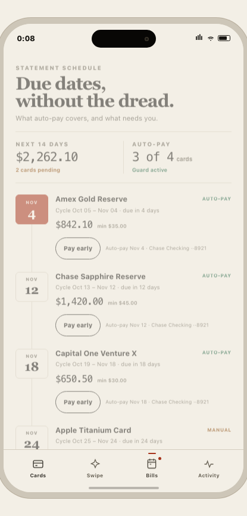
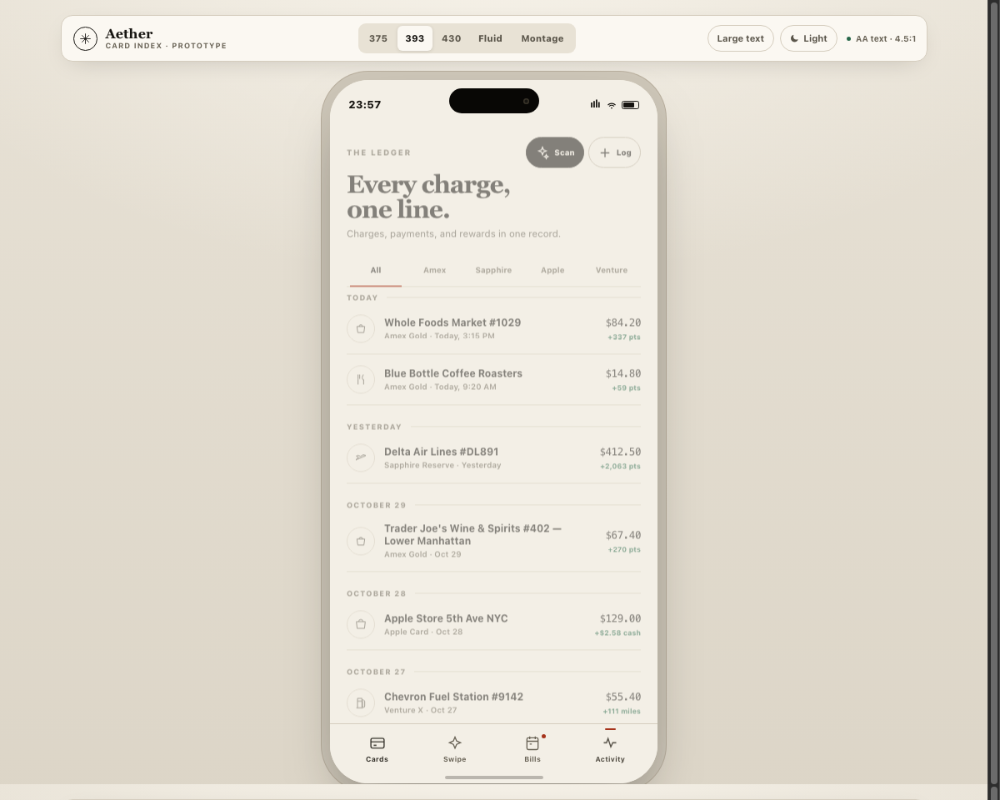

# Design Boss

<p align="center">
  <strong>Give your AI coding agent the taste, intuition, and discipline of a Principal Product Designer.</strong>
</p>

<p align="center">
  <a href="#why-you-need-this"></a>
  <a href="#accessibility--contrast"></a>
  <a href="#install"></a>
  <a href="LICENSE"></a>
</p>

---

## The Problem: We're All Tired of "AI Slop" UI

Have you ever asked an AI agent to build a mobile app, only to get the exact same cookie-cutter interface every single time?

- A generic greeting: *"Hello, John!"*
- Three identical rounded white boxes with blurry drop shadows (the dreaded *card-inside-a-card* syndrome).
- A blinding purple/blue gradient hero with floating bubbles.
- A floating action button clunkily punched right through the middle of the bottom navigation bar.
- Plaintext dummy data that clips and overflows the moment realistic merchant names or large accessibility text are turned on.

Great mobile design isn't just slapping cards onto a phone screen. It's **hierarchy**, **ergonomics**, **respecting platform conventions**, and **handling complex product logic** without making user promises the backend can't keep.

---

## The Solution: What `design-boss` Does

**`design-boss`** is an open Agent Skill that transforms how AI agents design and code mobile software. 

Instead of generating generic templates, your agent learns the workflow of a top-tier product design studio:

- **Bespoke Visual DNA**: Derives composition from your product's actual purpose and content—swapping endless card stacks for crisp typography, tactile surfaces, and hairline dividers.
- **Unbreakable Product Logic**: Automatically resolves real-world edge cases (e.g., auto-pay conflict protection, sensitive credential masking, transparent reward calculations).
- **Native Ergonomics**: Natural thumb zones, proper iOS/Android safe areas, and clean bottom navigation without awkward floating action buttons.
- **WCAG 2.2 AAA Contrast**: Zero guesswork. Comes with a zero-dependency contrast checker (`contrast_check.py`) to verify color pairs mathematically.
- **Dynamic Type Resilience**: Ensures interfaces reflow gracefully at 18px+ large text sizes without clipping or horizontal overflow.
- **Cross-Screen Coherence**: Keeps values, active states, and ledgers in sync across all screens in a flow.

---

## See It in Action: The Aether Wallet Showcase

We used `design-boss` to design and build **Aether Wallet**—a production-grade financial companion managing credit cards, rewards optimization, billing schedules, and transaction capture.

Here are the **exact iPhone 393px mobile frame captures** generated by the skill:

<div align="center">

| 1. Cards & Credit Health | 2. Smart Swipe Optimizer |
| :---: | :---: |
|  |  |
| **Tactile Cards & Biometric Privacy**<br>• Credit health meter with safe utilization tiers.<br>• In-place 3D card flipping without scroll jumps.<br>• Biometric Face ID unmasking for CVV with 30s auto-lock timer. | **Transparent Math & Wallet Ranking**<br>• Instant checkout decision: *"Which card to swipe?"*<br>• 4-card wallet stack-ranking comparison table.<br>• Transparent valuation formula with live purchase spend simulator. |

| 3. Bills & Due Dates | 4. Activity Ledger & Capture |
| :---: | :---: |
|  |  |
| **Zero Duplicate Debits Guaranteed**<br>• Explicit auto-pay conflict disclosure.<br>• Paying manually automatically zeroes out scheduled bank debits.<br>• Built-in bank network timeout test for honest failure recovery. | **Contextual Thumb Zone Capture**<br>• Fast `[AI Scan]` and `[+ Log]` buttons in header.<br>• AI SMS parser with graceful error recovery.<br>• Stress-tested against long strings (`Trader Joe's Wine & Spirits #402`). |

</div>

---

## How to Install

Works with any Agent Skills-compatible tool including **Antigravity**, **Claude Code**, **Cursor**, **Codex**, and **Gemini CLI**.

### Option A: Install via Skills CLI (Recommended)

```bash
# Add globally to all detected agents on your system
npx skills add shivareddyvanja/design-boss -g

# Or add to your current project directory
npx skills add shivareddyvanja/design-boss
```

### Option B: Local / Manual Install
Clone or symlink this repository into your agent's skills directory:

```bash
git clone https://github.com/shivareddyvanja/design-boss.git ~/.gemini/skills/design-boss
```

---

## How to Use

Once installed, your agent automatically knows how to apply mobile craft. You can invoke it explicitly or just talk naturally:

```text
"Design the onboarding and plot-claim flow for a community garden app. 
Make it feel grounded and earthy, not like a generic SaaS dashboard."
```

```text
"Review this checkout flow: check for auto-pay conflicts, ensure all text 
passes WCAG AAA contrast, and make sure large text doesn't clip."
```

```text
"Redesign our cards screen: replace the repeated card boxes with clean 
typographic hierarchy and add biometric CVV unmasking."
```

---

## Try the Demo Locally in 10 Seconds

Experience the interactive prototype right in your browser:

```bash
cd demo
python3 -m http.server 8080
```
Then visit **`http://localhost:8080`**.

- Click **`Large text`** in the toolbar to stress-test Dynamic Type reflow.
- Flip the cards to test **Face ID biometric unmasking** and countdown auto-relock.
- Pay a statement to observe **Auto-Pay Conflict Resolution** sync live into the Activity Ledger.
- Simulate bank network timeouts to test graceful error handling.

---

## Verification & Quality Gates

Every design created with this skill passes rigorous quality gates:

- **WCAG 2.2 AAA Contrast**: Primary text achieves **17.85:1** contrast; all interactive states exceed AA/AAA requirements.
- **Touch Targets**: All interactive controls maintain $\ge 44 \times 44\text{px}$ touch targets.
- **Anti-Template Audit**: Strictly avoids unexplained card stacks, floating action buttons, and decorative heroes that push primary tasks below the fold.
- **State Model**: Validated across ready, in-progress, failure recovery, locked, and settled states.

---

## Star the Project

If you believe mobile apps deserve better design than generic AI templates, give this repo a **Star**! It helps more developers and designers discover the skill.

---

## License

MIT © [Design Boss Contributors](LICENSE)
